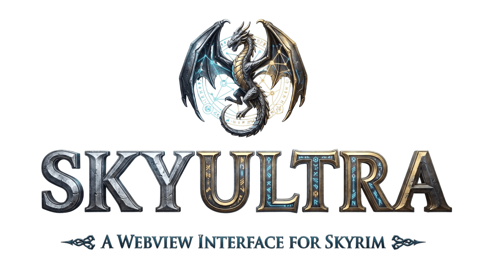

<div align="center">


# SkyUltra

HTML, CSS and JavaScript interfaces for Skyrim, with CEF and Ultralight browser engines, a native Direct3D 11 compositor, and an in-game command deck.

[Player guide](docs/USER_GUIDE.md) · [SDK guide](docs/SDK_GUIDE.md) · [Native API](api/README.md) · [Migration guides](docs/MIGRATION_GUIDE.md) · [Credits and libraries](docs/THIRD_PARTY_LIBRARIES.md)
</div>

## Player requirements

| Required | Details |
| --- | --- |
| Skyrim | A Windows SE, AE or VR runtime supported by your installed SkyUltra release. Match the executable version, not just the store's edition name. |
| SKSE64 or SKSEVR | Install [SKSE](https://skse.silverlock.org/) for that exact game runtime and launch through its loader. |
| Address Library | Install the matching [SE/AE Address Library](https://www.nexusmods.com/skyrimspecialedition/mods/32444) or [VR Address Library](https://www.nexusmods.com/skyrimspecialedition/mods/58101). A new game update also needs matching SKSE and address data. |
| Windows and graphics runtime | 64-bit Windows 10/11, the Microsoft Visual C++ x64 Redistributable, and a Direct3D 11-capable GPU/driver. |
| Complete SkyUltra release | Keep the plugin, web assets, scripts and browser runtime files supplied together. Browser libraries are bundled with the release; players do not install a browser SDK. |

SkyUI, ENB, Community Shaders, SSE Engine Fixes, TrueHUD and Wheeler are **not requirements**. They are separate mods; SkyUltra's installation does not depend on them. A particular graphics injector or mod combination still needs testing in your setup.

Install the release through your mod manager, enable it, and start Skyrim with SKSE. See the [player guide](docs/USER_GUIDE.md) for file locations and troubleshooting. The default menu hotkey is **Shift+F6**; settings allow rebinding it.

## What is included

- **Command deck:** overview, Actor Observatory, inventory, character sheet, settings, HUD workshop, Performance Lab, Developer Studio and the in-game guide.
- **Actor and item studios:** native model previews, creature portraits, captured animation frames, equipment inspection, lighting controls and PNG exports. Icons and portraits cache under `Data/SkyUltra/Cache/` (usually redirected to MO2 Overwrite or a configured output mod).
- **Menu replacements:** individual settings for inventory, barter, containers, corpse looting, pickpocketing, mannequins, magic and favorites.
- **HUD workshop:** visual widgets, a live code editor and manifest-based web-mod export.
- **Mod author interfaces:** a versioned C ABI, a header-only C++ helper, Papyrus functions, TypeScript/React packages, Vite integration and migration adapters/shims.

Views can select CEF or Ultralight independently when the host includes both. The current CMake defaults enable both and select CEF; shipped settings, a manifest's `browserEngine`, and per-mod/menu overrides may change the selection. Engine availability and page capabilities should be checked rather than inferred from another view. Performance Lab compares a particular workload; engine switching and frame rates are not timing guarantees.

Settings use `Data/SKSE/Plugins/SkyUltra.settings.json`; the INI is retired. CEF follows the display refresh by default with a 120 FPS maximum, and both engines honor lower per-view caps. The host accepts up to 1,024 pending native events per view with bounded, scheduled delivery and queue diagnostics. See [bridge delivery, performance and startup settings](docs/BRIDGE_DELIVERY.md) for limits, backpressure and engine constraints.

## Start developing

Use [the SDK walkthrough](docs/SDK_GUIDE.md) to create a manifest and page without C++. Use [the native API guide](api/README.md) for SKSE plugins or [the Papyrus SDK](sdk/papyrus/README.md) for script-driven views. The page bridge is **`window.SkyWebView`**.

```js
const bridge = window.SkyWebView;
if (!bridge) throw new Error('Load SkyUltraBridge.js before the application');
const off = bridge.on('sample.status', payload => console.log(payload));
await bridge.request('ui.pageReady', {});
// The manifest must grant each requested method. Call off() on cleanup.
```

Migration playbooks include package layouts, supported legacy shims, native API mappings, settings migration, lifecycle guidance and symptom-based troubleshooting:

| Porting from | Start here | First working proof |
| --- | --- | --- |
| PrismaUI | [PrismaUI migration](docs/PRISMAUI_MIGRATION.md) | [Matched manifest, page and native round trip](docs/PRISMAUI_MIGRATION.md#complete-a-native-round-trip) |
| Magelight UI | [Magelight UI migration](docs/MAGELIGHT_UI_MIGRATION.md) | [Manifest conversion](docs/MAGELIGHT_UI_MIGRATION.md#translate-the-manifest) and [real gameplay routing](docs/MAGELIGHT_UI_MIGRATION.md#route-real-gameplay-requests) |
| Other callback-style pages | [Shared migration steps](docs/MIGRATION_GUIDE.md) | [Plain bridge sample with live vitals and cleanup](samples/legacy-webview-port-sample/README.md) |

## Repository layout

| Directory | Contents |
| --- | --- |
| `api/` | Standalone native C header, C++ helper, CMake interface target and SKSE example |
| `src/`, `include/` | Native host, browser backends, compositor and game integrations |
| `resources/` | Bridge script, settings defaults, logos and splash assets |
| `apps/skyultra-menu/` | Built-in menu application |
| `sdk/typescript/` | `@skyultra/sdk` |
| `sdk/react/`, `sdk/ui/` | React hooks and optional components/styles |
| `sdk/vite-plugin/`, `sdk/create-skyultra-mod/` | Packaging plugin and scaffolder |
| `sdk/papyrus/` | Papyrus declarations and examples |
| `samples/` | React, plain web, HUD, legacy migration and diagnostic examples |
| `docs/`, `tools/` | Guides, dependency inventory and source/contract checks |

## Building from source

Native development needs Visual Studio 2022 with C++23 support, CMake **3.26+**, vcpkg, CommonLibSSE-NG and the browser SDKs enabled by the build. Configure the paths in [CMakePresets.json](CMakePresets.json); local paths are checkout-specific. Frontend Vite projects require Node **20.19+** and npm. Plain packaged JavaScript mods do not require Node on the player's computer.

For a developer who intends to build:

```powershell
# Read the script parameters before selecting package/install options.
Get-Help ./tools/Build-SkyUltraMenu.ps1 -Detailed
# With dependency paths configured:
cmake --preset local-release
cmake --build --preset local-release
```

The [SDK guide](docs/SDK_GUIDE.md) describes frontend-only project development and packaging. `Check-FrontendSource.cjs`, `Check-NativeSource.ps1` (`/Zs`), and the contract checks validate source without producing a release or establishing in-game compatibility.

## Thanks and acknowledgments

Special thanks to the **Chromium Embedded Framework (CEF)/Chromium**, **Ultralight/WebKit**, **SKSE** and **CommonLibSSE/CommonLibSSE-NG** teams and contributors. SkyUltra also relies on DirectXTK, DirectXMath, OpenVR, {fmt}, spdlog, nlohmann/json, rapidcsv, SimpleIni, toml11, Xbyak, HDE64, React, React DOM, Radix UI, Motion, Lucide, Zustand, Tailwind CSS, class-variance-authority, clsx, tailwind-merge, TypeScript, Vite, PostCSS, Autoprefixer and the tools and transitive libraries supporting them.

See [Credits and third-party libraries](docs/THIRD_PARTY_LIBRARIES.md) for upstream links, roles, retained notices and the [complete declared/locked dependency inventory](docs/dependencies/inventory.json). Thanks also to the PrismaUI and Magelight UI authors for their work on Skyrim web interfaces and their published integration APIs.
