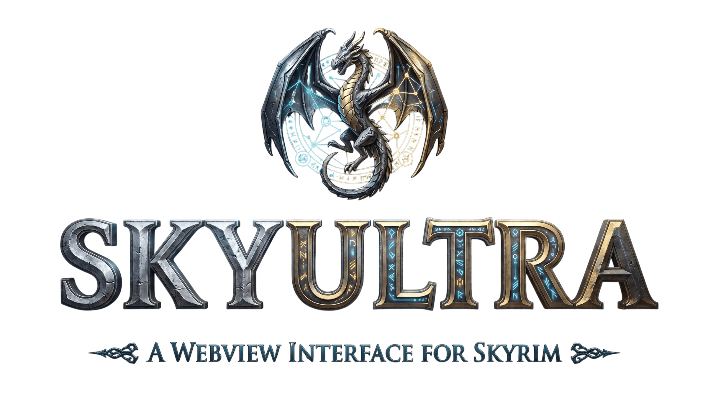

<div align="center">


# SkyUltra

**Next-Generation Hardware-Accelerated WebView Interface, 3D Studio & HUD Framework for Skyrim SE, AE, and VR.**

SkyUltra replaces static Scaleform limits with modern HTML, CSS, TypeScript, and React interfaces composited natively inside Skyrim's Direct3D 11 UI render pass — powered simultaneously by **Chromium (CEF)** and **Ultralight GPU**, real-time 3D FaceGen & `.nif` studios, a zero-latency shared-memory Sovereign Compass & Visual HUD Builder, 13 SWF menu & HUD carriers, and a complete zero-DLL / C++ / Papyrus modding SDK.

[Player guide](docs/USER_GUIDE.md) · [SDK guide](docs/SDK_GUIDE.md) · [Native API](api/README.md) · [Migration guides](docs/MIGRATION_GUIDE.md) · [Credits and contributors](docs/THIRD_PARTY_LIBRARIES.md)
</div>

## Why SkyUltra

SkyUltra is built as both a **complete, theme-driven Skyrim UI overhaul** out of the box and an **open, multi-engine WebView platform** for mod authors — with **zero dependencies on SkyUI, ENB, Community Shaders, SSE Engine Fixes, TrueHUD, or Wheeler**:

- **Simultaneous Dual-Engine Runtime (`CEF` + `Ultralight GPU`)**: Run **Chromium CEF** (display-aware Viz pacing up to **120 FPS**, merged dirty-rect D3D11 copies, lean **16-file** distribution) and **Ultralight GPU** (`30–240 Hz` presentation-synced rendering, prewarmed deferred D3D11 context, persistent JavaScriptCore batch dispatch) side-by-side in the same game session with independent per-mod and per-view engine routing.
- **Native D3D11 UI-Pass Compositing & Full Shader Mod Harmony**: On flat SE/AE, composites directly inside Skyrim's native UI render pass with scoped D3D11 state save/restore (no eager DXGI `Present` hook or `ClearState`) and skips idle compositor passes — preserving dynamic lighting, ENB, Community Shaders, and wearable lanterns without flicker or menu-blocking artifacts.
- **Zero-Latency Sovereign Compass & Visual 9-Zone HUD Studio**: Reads live player heading directly from native shared memory (`__skyultraReadLiveHeading`) with smooth frame-locked DOM motion, configurable **Compass Marker Radius (`50m`–`1000m`, default `50m`)** via slider, presets, or custom numeric input, 12 transparent HUD widgets, the 5-style **Dragonblade Portrait Crest** (with per-bar `SkyColorWheel` colors), 90% Safe-Area Guides, Layout JSON import/export, a Live HTML/CSS/JS Editor, and 1-click **zero-DLL HUD mod export**.
- **13 Zero-Overlap SWF Menu & HUD Carriers with Instant `Space` Search**: Full replacements for **Inventory**, **Barter**, **Storage Containers**, **Corpse & Monster Loot**, **Pickpocketing** (live native `%` badges & Stolen Protection), **Mannequins**, **Magic**, **Favorites**, **Blacksmithing** (forge, anvil, tanning, smelter, grindstone, workbench), **Arcane Enchanter** (List/Grid views, enchantment renaming, quest-aware disenchanting & skill-100 **Super Enchanting**), **Alchemy Lab** (4-column Grid/List views, trait tasting, Effect Matrix & Known Recipes, Purity perk cleansing, custom potion/poison naming & Distillation Altar batch crafting), **World Book Reader** (inherits Settings themes/designs, dynamic Skyrim Interact key to take/steal & close, `← / →` page turns), and **Compass** — guarded by session-epoch transition handshakes so menus never overlap across frames. Press **`Space`** immediately upon opening list menus to jump straight into search with no click required.
- **Real-Time 3D Actor Observatory & Item Studio**: Live 3D Dragonborn FaceGen portrait (including worn headgear), nearby NPC & creature portraits with camera presets (`Bust`, `3/4 View`, `Full Body`, `Profile`), 11-slot drag-and-drop wardrobe dressing, asynchronous cached DXBC preview shaders (`Data/SkyUltra/Cache/ActorPreviewShaders.dxbc.bin`), and transparent PNG exports up to **4096×4096 (`4K`)**.
- **21 Themes, Per-Character Profiles & Keyboard / Gamepad / VR Equality**: Four curated palettes (**Eye-Comfort Velvet Slate**, **Classic**, **Celestial**, **Neon**) with a 360° `SkyColorWheel` cursor/accent picker, a theme-synced 7-design Book Reader, motion tab splash, Full Analog **V-Cursor**, Virtual Keyboard (`Shift+K`), 1–3 input chords, and first-class **Skyrim VR (`atGaze` + dual-hand laser)** support.
- **Performance Lab, Developer Studio & Mod Migration Shims**: End-to-end sampled pipeline telemetry (`p50`/`p95`/`p99`), D3D11 GPU compositor queries, real-time Bridge Latency Profiler, 1-click Diagnostic Bundle export, live hot-reload watcher, broken manifest doctor, and compatibility shims/playbooks for PrismaUI and Magelight UI.

## Player requirements

| Required | Details |
| --- | --- |
| Skyrim | A Windows SE, AE or VR runtime supported by your installed SkyUltra release. Match the executable version, not just the store's edition name. |
| SKSE64 or SKSEVR | Install [SKSE](https://skse.silverlock.org/) for that exact game runtime and launch through its loader. |
| Address Library | Install the matching [SE/AE Address Library](https://www.nexusmods.com/skyrimspecialedition/mods/32444) or [VR Address Library](https://www.nexusmods.com/skyrimspecialedition/mods/58101). A new game update also needs matching SKSE and address data. |
| Windows and graphics runtime | 64-bit Windows 10/11, the Microsoft Visual C++ x64 Redistributable, and a Direct3D 11-capable GPU/driver. |
| Complete SkyUltra release | Keep the plugin, web assets, scripts and browser runtime files supplied together. Browser libraries are bundled with the release; players do not install a browser SDK. |

SkyUI, ENB, Community Shaders, SSE Engine Fixes, TrueHUD and Wheeler are **not requirements**. They are separate mods; SkyUltra's installation does not depend on them. A particular graphics injector or mod combination still needs testing in your setup.

Install the release through your mod manager, enable it, and start Skyrim with SKSE. See the [player guide](docs/USER_GUIDE.md) for file locations and troubleshooting. The default menu hotkey is **Shift+F6**; settings allow rebinding it.

## What is included

- **Command deck (Modules `01`–`09`):** Overview command dossier, Actor Observatory (tri-vitals, pinning, filters/sort & camera presets), Inventory (smart chips, `V/W` sort, inline item renaming, pack weight/encumbrance telemetry, 4 quick loadouts, 7-design Book Reader), Character Sheet (18 skill crests, EHP/armor cap telemetry, Markdown/JSON build dossier export), cleanly separated Settings (Themes & Visuals, Inventory & Barter, Hotkeys & VR, Opening Splash, Engine & Runtime), Visual HUD Studio, Performance Lab, Developer Studio (Bridge Latency Profiler, Diagnostic Bundle export & Modder Workbench) and the in-game SkyUltra Guide.
- **Actor and item studios:** Native model previews, upright creature portraits, captured animation frames, camera presets, 11-slot equipment inspection, lighting controls and PNG exports. Preview shaders compile asynchronously off-thread and cache DXBC bytecode to `Data/SkyUltra/Cache/ActorPreviewShaders.dxbc.bin` (redirected to MO2 Overwrite or a configured output mod) alongside cached icons and portraits so opening Actor Observatory or Inventory does not stall cursor movement.
- **Zero-overlap menu & HUD carriers:** Individual toggles for inventory, barter, containers, corpse looting (`Smart Loot Valuables` & `Take & Equip/Consume/Read`), pickpocketing (`%` chance badges & stolen protection), mannequins, magic, favorites, blacksmithing (`skyultra_blacksmith.swf`), arcane enchanting (`skyultra_enchanting.swf` with List/Grid view, enchantment renaming & Enchanting-100 **Super Enchanting** supporting unrestricted slots, unlimited effects, per-item batch renaming, stack quantity sliders, and strict 1:1 auto-filled soul gems), alchemy lab (`skyultra_alchemy.swf` with 4-column Grid/List views, trait tasting, Effect Matrix & Known Recipes, Purity perk cleansing, custom potion/poison naming, Distillation Altar batch controls, and native Skyrim & SkyRewrite action wiring), world book reader (`skyultra_book.swf` obeying Settings styles, world pause, bound Interact key & `← / →` arrow page turns), and compass HUD (`50m`–`1000m` configurable marker radius), backed by session-epoch transition gating and instant `Space` search focus.
- **HUD workshop:** 5-style **Dragonblade Portrait Crest** (Dragonblade Relic, Daedric Ebony, Dwemer Automaton, Aetherial Silver, Nordic Carved) with per-bar `SkyColorWheel` customization for HP/Magicka/Stamina, Sovereign Compass Marker Radius (`50m`–`1000m`, default `50m`), 90% Safe-Area Guides, Layout JSON import/export, Live Code Editor and manifest-based zero-DLL web-mod export.
- **Mod author interfaces:** Versioned C ABI, header-only C++ helper, Papyrus functions, TypeScript/React/UI Kit packages (`@skyultra/sdk`, `@skyultra/react`, `@skyultra/ui`), Vite plugin & scaffolder, DevStudio Modder Workbench (Bridge Playground, TS/JS/Papyrus snippet generator, visual `manifest.json` builder & `--sky-*` token inspector) and migration adapters/shims.
- **Lean CEF distribution:** Packaged into 16 runtime files under `SKSE/Plugins/SkyUltra/CEF/` (shipping `locales/en-US.pak` only) with `SkyUltraCefSubprocess.pdb` staged separately into `Diagnostics/`.

Views can select CEF or Ultralight independently when the host includes both. The current CMake defaults enable both and select CEF; shipped settings, a manifest's `browserEngine`, and per-mod/menu overrides may change the selection. Engine availability and page capabilities should be checked rather than inferred from another view. Performance Lab compares a particular workload; engine switching and frame rates are not timing guarantees.

Settings use `Data/SKSE/Plugins/SkyUltra.settings.json`; the INI is retired. When uncapped (`max_fps == 0` or `SKYULTRA_FPS_UNCAPPED`), CEF uses Chromium's internal Viz `BeginFrame` scheduler matching the active display refresh rate clamped to **1–120 FPS** (with staggered hidden-view priming and merged dirty-rect GPU copies), Ultralight prewarms its D3D11 deferred-context renderer at startup and drives presentation-synced rendering across **30–240 Hz** with bounded GPU command-list backpressure and persistent JavaScriptCore batch dispatch, built-in menus/HUD widgets follow display-aware backend cadence with coalescing `skyultra.compassHeading` updates and Performance Lab end-to-end sampled traces (`p50`/`p95`/`p99`), both engines honor explicit lower per-view caps (`1–120` in CEF, `1–240` in Ultralight), and the opening splash video prewarms frame 0 off-thread without an opaque black loading backdrop. Cached icons/portraits under `Data/SkyUltra/Cache/` work transparently across both native directories and MO2 USVFS virtual mounts. The host accepts up to 1,024 pending native events per view with bounded, scheduled delivery and queue diagnostics. See [bridge delivery, performance and startup settings](docs/BRIDGE_DELIVERY.md) for limits, backpressure and engine constraints.

Developer Studio can suspend, resume or unload a mod's browser pages. Per-mod budgets bound view counts, surface reservations and aggregate bridge buffers. CEF records renderer/context failures, performs bounded renderer recovery, and supports optional local crash dumps. See [runtime resilience and diagnostics](docs/RUNTIME_RESILIENCE.md) for behavior, limits and the explicit crash-reporting setup. These controls do not give every mod its own Chromium GPU process.

## Start developing

Use [the SDK walkthrough](docs/SDK_GUIDE.md) to create a manifest and page without C++. Use [the native API guide](api/README.md) for SKSE plugins or [the Papyrus SDK](sdk/papyrus/README.md) for script-driven views. The page bridge is **`window.SkyWebView`**.

```js
const bridge = window.SkyWebView;
if (!bridge) throw new Error('Load SkyUltraBridge.js before the application');
const off = bridge.on('sample.status', payload => console.log(payload));
await bridge.request('ui.pageReady', {});
// The manifest must grant each requested method. Call off() on cleanup.
```

Migration playbooks include package layouts, supported legacy shims, native API mappings, settings migration, lifecycle guidance and symptom-based troubleshooting:

| Porting from | Start here | First working proof |
| --- | --- | --- |
| PrismaUI | [PrismaUI migration](docs/PRISMAUI_MIGRATION.md) | [Matched manifest, page and native round trip](docs/PRISMAUI_MIGRATION.md#complete-a-native-round-trip) |
| Magelight UI | [Magelight UI migration](docs/MAGELIGHT_UI_MIGRATION.md) | [Manifest conversion](docs/MAGELIGHT_UI_MIGRATION.md#translate-the-manifest) and [real gameplay routing](docs/MAGELIGHT_UI_MIGRATION.md#route-real-gameplay-requests) |
| Other callback-style pages | [Shared migration steps](docs/MIGRATION_GUIDE.md) | [Plain bridge sample with live vitals and cleanup](samples/legacy-webview-port-sample/README.md) |

## Repository layout

| Directory | Contents |
| --- | --- |
| `api/` | Standalone native C header, C++ helper, CMake interface target and SKSE example |
| `src/`, `include/` | Native host, browser backends, compositor and game integrations |
| `resources/` | Bridge script, settings defaults, logos and splash assets |
| `apps/skyultra-menu/` | Built-in menu application |
| `sdk/typescript/` | `@skyultra/sdk` |
| `sdk/react/`, `sdk/ui/` | React hooks and optional components/styles |
| `sdk/vite-plugin/`, `sdk/create-skyultra-mod/` | Packaging plugin and scaffolder |
| `sdk/papyrus/` | Papyrus declarations and examples |
| `samples/` | React, plain web, HUD, legacy migration and diagnostic examples |
| `docs/`, `tools/` | Guides, dependency inventory and source/contract checks |

## Building from source

Native development needs Visual Studio 2022 with C++23 support, CMake **3.26+**, vcpkg, CommonLibSSE-NG and the browser SDKs enabled by the build. Configure the paths in [CMakePresets.json](CMakePresets.json); local paths are checkout-specific. Frontend Vite projects require Node **20.19+** and npm. Plain packaged JavaScript mods do not require Node on the player's computer.

For a developer who intends to build:

```powershell
# Read the script parameters before selecting package/install options.
Get-Help ./tools/Build-SkyUltraMenu.ps1 -Detailed
# With dependency paths configured:
cmake --preset local-release
cmake --build --preset local-release
```

The [SDK guide](docs/SDK_GUIDE.md) describes frontend-only project development and packaging. `Check-FrontendSource.cjs`, `Check-NativeSource.ps1` (`/Zs`), and the contract checks validate source without producing a release or establishing in-game compatibility.

## Project Contributors & Special Thanks

SkyUltra would not be what it is today without the talented creators who helped bring its visuals, presentation, HUD, and menus to life:

| Contributor | Role & Contributions | Profile |
| --- | --- | --- |
| **Marty Edwar** | Created the **SkyUltra Opening Splash Screen**, performed the **voice-over** in it, and helped with **HUD development**. | [`@martinedwar1` on Instagram](https://www.instagram.com/martinedwar1) |
| **StabbyINK** | Helped with the **UI/UX design** and the **development of SkyUltra Menus**. | [StabbyINK on Nexus Mods](https://www.nexusmods.com/profile/StabbyINK) |

## Thanks and acknowledgments

Special thanks to the **Chromium Embedded Framework (CEF)/Chromium**, **Ultralight/WebKit**, **SKSE** and **CommonLibSSE/CommonLibSSE-NG** teams and contributors. SkyUltra also relies on DirectXTK, DirectXMath, OpenVR, {fmt}, spdlog, nlohmann/json, rapidcsv, SimpleIni, toml11, Xbyak, HDE64, React, React DOM, Radix UI, Motion, Lucide, Zustand, Tailwind CSS, class-variance-authority, clsx, tailwind-merge, TypeScript, Vite, PostCSS, Autoprefixer and the tools and transitive libraries supporting them.

See [Credits and third-party libraries](docs/THIRD_PARTY_LIBRARIES.md) for contributor details, upstream links, roles, retained notices and the [complete declared/locked dependency inventory](docs/dependencies/inventory.json). Thanks also to the PrismaUI and Magelight UI authors for their work on Skyrim web interfaces and their published integration APIs.
