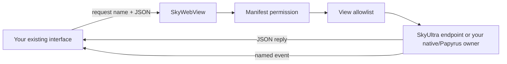

# Moving a PrismaUI mod to SkyUltra

**Keep your interface. Port its connection to Skyrim. Verify one complete interaction before moving the rest.**

This guide is for authors of an existing PrismaUI mod. It takes you from a working page to a manifest, a native request/reply, preserved legacy callbacks, and a release you can test. Plain JavaScript, React, Vue and other frontend choices can keep their own design; SkyUltra's menu and component library are optional.

**Start here:** [SDK setup](SDK_GUIDE.md) · [C/C++ API](../api/README.md) · [Papyrus](../sdk/papyrus/README.md) · [Magelight UI migration](MAGELIGHT_UI_MIGRATION.md)

## Contents

1. [Choose your migration path](#choose-your-migration-path)
2. [What carries over](#what-carries-over)
3. [Package the page](#package-the-page)
4. [Complete a native round trip](#complete-a-native-round-trip)
5. [Keep the legacy shims](#keep-the-legacy-shims)
6. [Map existing callbacks to gameplay](#map-existing-callbacks-to-gameplay)
7. [Translate the native API](#translate-the-native-api)
8. [Own readiness and lifecycle](#own-readiness-and-lifecycle)
9. [Choose engines and control cost](#choose-engines-and-control-cost)
10. [Move settings and distribute the port](#move-settings-and-distribute-the-port)
11. [Diagnose a failed port](#diagnose-a-failed-port)
12. [Validate before release](#validate-before-release)

## Choose your migration path

| Your existing mod | First useful milestone | Integration |
| --- | --- | --- |
| A page using player data and built-in actions | Display one real snapshot and close correctly | `SkyWebView.request` / SDK helpers; [plain page sample](../samples/legacy-webview-port-sample/README.md) |
| A large frontend with callback-style code | Keep its function names while replacing their transport | [Explicit name adapter](#map-existing-callbacks-to-gameplay) |
| Code already written for SkyUltra's Prisma-shaped helpers | Install the supported helpers and verify their echo | [Legacy shims](#keep-the-legacy-shims) |
| An SKSE DLL registering PrismaUI listeners | Deliver one custom native request and response | [C/C++ mapping](#translate-the-native-api) and the worked example below |
| A quest/script should own the replacement | Create a view and handle a request from Papyrus | [Papyrus SDK](../sdk/papyrus/README.md) |

Start with a panel you understand. List its old listener names, pushed events, native actions, settings and opening/closing rules. Port one visible action, such as changing a setting and receiving its confirmed value, before moving every screen.

> [!IMPORTANT]
> SkyUltra includes working frontend legacy shims. An existing DLL linked to PrismaUI still needs its native integration ported. The shim names do not make the two native function tables interchangeable.

If the current release meets your needs, migration can wait. Reasons to evaluate SkyUltra include its CEF/Ultralight choices, explicit JSON bridge, shared game subscriptions, native actor/item previews, Papyrus integration and author tools. These are capabilities to evaluate with your own page; this guide makes no cross-host FPS or load-time promises.

## What carries over

| Usually reusable | Review or replace |
| --- | --- |
| Layout, styles, images, local fonts and frontend state | Paths, module loading and browser-specific features |
| React/Vue components and application routing | Host bridge initialization and teardown |
| Pure JavaScript calculations and view models | Globals injected by the old native owner |
| Your gameplay implementation | Its request dispatcher, validation and completion path |
| Your settings schema | Where settings live and how old values are imported |

The direction of communication matters. PrismaUI's native [`InteropCall`](https://www.prismaui.dev/api/interop-call/) calls a page function with a string. Native [`RegisterJSListener`](https://www.prismaui.dev/api/register-js-listener/) makes a page-callable native listener. In SkyUltra, these become **native-to-page events** and **page-to-native requests**, respectively. The JavaScript shim methods described later are page-side helpers with a separate contract.



Events and requests have different jobs: requests return success or an error; events deliver updates to subscribers. Event names do not belong in `permissions.pageRequests` unless a request separately uses that name.

## Package the page

Use the SkyUltra project root containing `docs/`, `sdk/` and `api/`. The [SDK guide](SDK_GUIDE.md#choose-a-starting-point) covers the local scaffolder and frontend tools; the package names here do not imply that every package is published to npm.

Installed layout for the worked example:

```text
Data/
  SkyUltra/
    sample.native/
      manifest.json
      Files/
        index.html
        SkyUltraBridge.js
        assets/                 # your locally bundled CSS, images and fonts
```

`manifest.json`:

```json
{
  "schemaVersion": 1,
  "id": "sample.native",
  "name": "PrismaUI migration wire test",
  "version": "1.0.0",
  "entry": "Files/index.html",
  "permissions": {
    "storage": false,
    "assetAccess": true,
    "networkHosts": [],
    "pageRequests": ["ui.pageReady", "sample.ping"]
  }
}
```

For your real mod, replace the sample identity everywhere and grant its actual methods. Keep the folder and lowercase `id` aligned. The manifest has **one `entry`**; multiple independently declared entry pages need separate manifests, or use routing within one application. A manifest declares the package; its native/Papyrus owner or SkyUltra's configured mod integration still creates and opens the view.

For a plain page, copy [SkyUltraBridge.js](../resources/SkyUltraBridge.js) beside the HTML and load it first. For Vite, the [SkyUltra plugin](../sdk/vite-plugin/README.md) inserts the bridge and packages the root manifest plus `Files/`. Keep `base: './'`, relative assets and local fonts. Move your existing build output rather than copying an entire `node_modules` folder into the mod.

## Complete a native round trip

This is a small **native wiring test**, with matching page, manifest and C++ method names. It proves that a custom request reached your ported DLL and that the reply and pushed event reached the page. It does not pretend to implement your mod's gameplay.

Place this in `Files/index.html`:

```html
<!doctype html>
<html lang="en">
<meta charset="utf-8">
<title>SkyUltra migration wire test</title>
<style>
  body { margin: 32px; color: #edf2f7; background: #111820; font: 16px system-ui; }
  button { padding: 10px 16px; } output { display: block; margin: 16px 0; }
</style>
<h1>Native bridge wire test</h1>
<output id="reply" role="status">Connecting…</output>
<output id="event">Waiting for the native event…</output>
<button id="ping" disabled>Ping native owner</button>
<script src="./SkyUltraBridge.js"></script>
<script>
  const bridge = window.SkyWebView;
  const controller = new AbortController();
  const reply = document.getElementById('reply');
  const pingButton = document.getElementById('ping');
  if (!bridge) {
    reply.textContent = 'Bridge unavailable: load SkyUltraBridge.js before this script.';
    throw new Error(reply.textContent);
  }
  let disposed = false;
  const stop = bridge.on('sample.status', payload => {
    if (!disposed) document.getElementById('event').textContent =
      payload.connected ? 'Native event received.' : 'Native owner disconnected.';
  });
  async function ping() {
    pingButton.disabled = true;
    try {
      const result = await bridge.request('sample.ping', {}, { signal: controller.signal });
      if (!disposed) reply.textContent = result.message;
    } catch (error) {
      if (!disposed) reply.textContent = 'Request failed: ' + error.message;
    } finally {
      if (!disposed) pingButton.disabled = false;
    }
  }
  pingButton.addEventListener('click', () => void ping());
  window.addEventListener('pagehide', () => {
    disposed = true;
    stop();
    controller.abort();
  }, { once: true });
  bridge.request('ui.pageReady', {}, { signal: controller.signal })
    .then(() => { if (!disposed) return ping(); })
    .catch(error => { if (!disposed) reply.textContent = error.message; });
</script>
</html>
```

Use [MinimalSksePlugin.cpp](../api/examples/MinimalSksePlugin.cpp) as the native owner. It already uses `sample.native`, grants `ui.pageReady` and `sample.ping`, replies with `{"message":"Hello from SKSE"}`, and sends `sample.status`. Add the supplied [API include tree](../api/include/SkyUltra/) to that consumer project's includes. Its SKSE metadata/build setup remains part of your plugin project.

**Success looks like:** the page shows **Hello from SKSE** and **Native event received**. Pressing the button repeats the same request. A browser-only mock can test the page layout; it cannot prove this native route worked.

The complete native example uses the host's **one global custom-request callback slot**. A later callback registration replaces it. Coordinate a shared dispatcher when combining native consumers; per-view allowlists do not create independent callback slots.

## Keep the legacy shims

Install the production helpers before your adapted legacy application starts:

```ts
import { getSkyWebView, installSkyUltraCompetitorShims } from '@skyultra/sdk';

const bridge = getSkyWebView();
const shims = installSkyUltraCompetitorShims(window, bridge);
const stop = shims.prismaUI.RegisterJSListener('port.preview', jsonText => {
  console.log('Compatibility payload:', JSON.parse(String(jsonText)));
});

await shims.prismaUI.InteropCall('port.preview', { enabled: true });
// On page/app teardown:
// stop(); shims.uninstall();
```

Grant `ui.interopCall` in both applicable permission lists for this example. The built-in SkyUltra menu installs its helpers; an independent page opts in. The bridge file alone does not inject the shim globals.

| Helper | Current behavior | Migration consequence |
| --- | --- | --- |
| `prismaUI.RegisterJSListener(name, fn)` | Subscribes to a direct event and matching Prisma shim envelope; returns an unsubscribe function | Its callback receives a string; object payloads are serialized |
| `prismaUI.InteropCall(name, payload)` | Requests `ui.interopCall`; the host echoes to that same view | Useful for compatibility messaging, not a custom gameplay dispatcher |
| `prismaUI.Invoke(script)` | Executes locally in the page; failures return `undefined` | Replace native-dependent scripts with named requests/events |
| `SetOrder` / `GetOrder` | Store/read a rounded compatibility value | Configure actual native layer and `z_index` through the owner |
| `shims.uninstall()` | Removes registered listeners and restores previous globals when still owned | Call when the application that installed the shims is torn down |

The installed aliases include `window.prismaUI`, `window.RegisterJSListener` and `window.InteropCall`. They do **not** manufacture arbitrary old globals such as `window.castSpell`; map those explicitly in the next section. Framework envelopes are isolated, so a Magelight shim message with the same method name does not reach a Prisma shim listener.

> [!TIP]
> In Developer Studio, **Verify Active Shims** displays inline results for API presence and the host listener echo. A passing echo proves the compatibility bus, not your old DLL's gameplay handler. Repeat your real gameplay round trip as a separate test.

## Map existing callbacks to gameplay

Suppose the old page calls `window.saveSettings(jsonText)` and defines `window.updateStatus(jsonText)`. Preserve those function names while moving their transport to explicit contracts:

```ts
import { createSkyUltraLegacyBridgeAdapter, getSkyWebView } from '@skyultra/sdk';

const bridge = getSkyWebView();
const legacy = createSkyUltraLegacyBridgeAdapter(bridge, {
  methodMap: { saveSettings: 'port.saveSettings' },
  eventMap: { updateStatus: 'port.state' },
});

// Keep these references local to your adapter/bootstrap module.
const oldWindow = window as unknown as {
  saveSettings?: (text: string) => Promise<unknown>;
  updateStatus?: (text: string) => void;
};
const previousSave = oldWindow.saveSettings;
const saveSettings = (text: string) => legacy.call('saveSettings', JSON.parse(text));
oldWindow.saveSettings = saveSettings;
const stop = legacy.listen('updateStatus', payload => {
  oldWindow.updateStatus?.(JSON.stringify(payload));
});
await legacy.ready();

window.addEventListener('pagehide', () => {
  stop();
  if (oldWindow.saveSettings === saveSettings) {
    if (previousSave) oldWindow.saveSettings = previousSave;
    else delete oldWindow.saveSettings;
  }
}, { once: true });
```

Add `port.saveSettings` to the manifest **and** the native view allowlist, then implement it in your owner. Validate the decoded payload, apply the setting, return a JSON reply, and push `port.state` when useful. A missing name mapping falls through to that original name; it does not invent a host implementation. Requests are asynchronous, so update old callers to await completion or handle a rejection.

`ui.pageReady` is consumed by SkyUltra to release its startup gate. It is not forwarded to your custom native callback. If your owner needs an application-ready handshake or initial state request, declare a separate custom method, such as `port.getInitialState`, and call it after listeners are attached. The wire test uses `sample.ping` for that first exchange.

## Translate the native API

Use [NativeAPI.h](../api/include/SkyUltra/NativeAPI.h) for the exported C ABI or [SkyUltraAPI.hpp](../api/include/SkyUltra/SkyUltraAPI.hpp) for its C++20 helper. They are two layers of the **same** API. The helper acquires V4 from the loaded DLL; it does not silently fall back to older tables and needs no SkyUltra import library.

| PrismaUI native operation | SkyUltra destination | Detail to keep explicit |
| --- | --- | --- |
| Acquire the PrismaUI API | `SkyUltra::Client::Acquire()` | Handle a missing/not-yet-ready host without blocking |
| `CreateView(path, onDomReady)` | `RegisterMod` then `CreateView` | The registered manifest supplies `entry`; app readiness is a separate handshake |
| `Show` / `Hide` | `SetVisible(view, true/false)` | Keep your own open/close state consistent with host events |
| `Destroy` | `DestroyView` | Acceptance and eventual destruction are separate |
| `IsValid` | `GetViewState` result and lifecycle enum | Pending, ready, failed or closing; this is not an app-ready signal |
| `IsHidden` | Track visibility in your owner | `GetViewState` is a lifecycle enum, not a hidden-state/flags structure |
| `InteropCall` | `SendEventJson` + `SkyWebView.on` | Send JSON data and subscribe before pushing initial state |
| `RegisterJSListener` | `SkyWebView.request` + custom request callback | Manifest grant, view grant, validation and completion are all needed |
| `Invoke` with a result callback | A named request returning JSON | No arbitrary native script-evaluation entry in the exported ABI |
| `Focus` / `Unfocus`, focus-menu flag edits | Redesign around your view's layer, flags and visibility/input ownership | There is no exported independent focus setter; hiding is also a visibility change |
| `HasFocus` / `HasAnyActiveFocus` | Your owner/input coordination | No equivalent global focus query is exported; account for other hosts explicitly |
| `SetOrder` / `GetOrder` | Native layer and `z_index` configuration | The frontend shim's stored order does not reorder native surfaces |
| Scroll/inspector helpers | Page scrolling and SkyUltra Developer Studio tools | No matching native scroll-step/inspector function family in this ABI |
| A console callback | Developer Studio bridge errors and host/browser logs | Preserve your own application logging as well |
| Recreate to refresh the page | `ReloadView`; raw API navigation where appropriate | Reload reinstalls listeners and loses page-local state |

The [native guide](../api/README.md#requests-replies-and-cancellation) specifies the callback signature. IDs are **string spans**; callback arguments are borrowed and must be copied before retaining them. Custom request callbacks arrive on the game thread. Background computation may complete a request later, but access to game objects still belongs on the game thread. Handle cancellation and do not complete an already-cancelled request.

## Own readiness and lifecycle

Treat these as separate milestones: **view accepted → browser/page loaded → listeners installed → app ready → initial data delivered**. Native `READY` does not mean a React component has mounted its event listeners. Do not send the only copy of initial state before the page can receive it; use a pull request or explicit application handshake.

For an interactive panel, configure the owner and input flags appropriately. For a passive HUD, use the HUD layer and click-through behavior. Remove old Prisma-specific focus-menu manipulation from the port once its replacement lifecycle exists. Retaining two Escape handlers or two owners of the same hotkey can make a correctly rendered page unusable.

Track both host and browser visibility for page work:

```ts
import { getSkyWebView } from '@skyultra/sdk';
const bridge = getSkyWebView();
const hostVisible = () => bridge.getVisibility?.().visible !== false;
const canDoVisibleWork = () => hostVisible() && !document.hidden;
const stop = bridge.on('skyultra.visibility', () => {
  console.log('Refresh visible layout when appropriate:', canDoVisibleWork());
});
// On teardown: stop(); cancel RAF/timers; abort requests; close owned previews.
```

Do not depend on a hidden page's next animation frame to release native input or close the view. Abort stale reads and unsubscribe on teardown. Cancellation stops delivery/remaining work where supported; it does not undo a gameplay mutation that already finished. If a page owns a native actor/item stage, hide it as navigation starts and close it when unmounted so it cannot float over the next page.

## Choose engines and control cost

An omitted `browserEngine` follows host configuration. A top-level `"browserEngine": "cef"` or `"browserEngine": "ultralight"` pins the mod's selection, subject to the available backend. Query `getSkyUltraRuntimeInfo()` to record what actually ran. A PrismaUI page still needs testing on the target browser; review the specific CSS, canvas, input, fonts and media features it uses.

For game telemetry, share a feed rather than attaching one polling loop per component:

```ts
import { getSkyWebView, subscribeSkyUltraGame } from '@skyultra/sdk';
const subscription = subscribeSkyUltraGame(getSkyWebView(), event => {
  if (event.available) console.log(event.snapshot.health);
}, { scope: 'hud', topics: ['vitals'], intervalMs: 250 });
// On teardown: subscription.unsubscribe();
```

Keep bridge messages bounded: requests have a 64 KiB serialized envelope limit. Send changed data, not a complete inventory every animation frame. Keep HUD bounds and resolution appropriate to its content, and pace infrequent background work. These choices protect frame time without lowering the page's visual quality.

Use the same page, viewport, widgets and game scene when comparing CEF and Ultralight. Performance Lab separates browser callbacks, host compositor timing and Present cadence; its host GPU numbers do not include CEF subprocess rendering. Startup wall time can include hidden prewarming and waiting at the title screen. Measure visible-opening latency separately, and use game-frame measurements for claims about gameplay FPS.

## Move settings and distribute the port

Keep the existing settings format if it works. Browser storage belongs to the old host's environment and does not automatically move with your HTML. Prefer a versioned export/import or your existing native/Papyrus save data; validate imported fields, preserve a backup, and make migration safe to repeat. Grant `storage` if your new package needs persistent host storage. Moving the UI must not silently erase a player's configuration.

Ship the installed `manifest.json` and complete `Files/` subtree, the ported owner if needed, and appropriate notices for assets/libraries you redistribute. Update your installer and description to name SkyUltra for the migrated edition. A player using unrelated PrismaUI mods may still need PrismaUI; do not tell them to remove it globally. Use distinct package identities and hotkeys during testing so the two editions do not both respond to one action.

SkyUI, ENB and Community Shaders are not requirements of this port. Keep optional interoperability notes separate from actual dependencies. Review [third-party notices](THIRD_PARTY_LIBRARIES.md) before redistributing host/runtime binaries; requiring the host is different from bundling its libraries.

## Diagnose a failed port

| Symptom | Check first | Concrete next step |
| --- | --- | --- |
| Blank page | Entry, relative assets, bridge load order, browser console | Verify the installed `Files/` tree and Developer Studio's resolved URL |
| `SkyWebView` is undefined | Missing/late bridge script | Load `SkyUltraBridge.js` before application code; capitalization matters |
| Legacy global is undefined | Shim install order or an arbitrary old native listener | Install helpers early; map custom globals explicitly |
| Interop says accepted but gameplay never changes | Same-view shim echo mistaken for native execution | Call a mapped custom request and implement its owner |
| Permission denied | Manifest grant and per-view allowlist | Add the exact method to both; neither list overrides the other |
| Custom request times out | Missing/replaced callback, wrong method, no completion | Log the sender/method and inspect callback ownership |
| First state update disappears | Native push precedes subscription | Subscribe first; request the current state after app initialization |
| UI closes but a model remains | Native preview lifecycle | Hide before route change, cancel pending updates, close on teardown |
| Settings reset | New storage identity or failed import | Verify persistence permissions and the versioned import path |
| Slow opening or a huge startup number | Hidden time, lazy work, native collection, engine startup | Separate cold start from visible opening; inspect the same workload on each supported backend |
| Map cursor or another menu breaks | Conflicting owners/hotkeys or retained old focus hooks | Test the port alone, then alongside the old host and your real mod list |

Use Developer Studio's views, bridge log, diagnostics and **Verify Active Shims**, plus `SkyUltra.log` and `SkyUltra_CEF.log` for CEF-specific failures. A shim pass, a rendered browser preview and a successful native gameplay call are three different results.

## Validate before release

- [ ] The manifest and installed paths agree; only requested methods are granted.
- [ ] The real native/Papyrus action returns the expected result, not just a shim echo.
- [ ] Initial state survives first open, repeated opens, reload and save/load.
- [ ] Closing releases input, listeners, timers, pending reads and owned previews.
- [ ] Text entry, controller input, map dialogs and other menus behave correctly.
- [ ] Every advertised browser engine and game/VR configuration has been tested. Native actor/item preview compositing currently reports unsupported in VR; spatial/UI testing is separate.
- [ ] Settings import preserves player data and handles a second import safely.
- [ ] Old and migrated editions have been tested together where that is supported, with clear hotkey/owner selection.

With the checkout's author-tool dependencies installed, run these **source-only checks** from the SkyUltra project root. They are not an in-game certification:

```powershell
node tools/Check-DocumentationSource.cjs
node tools/Check-LegacyShims.cjs
node tools/Check-MigrationExamples.cjs
```

## References and thanks

Thanks to the PrismaUI authors for their framework and [published API](https://www.prismaui.dev/), and to Severause and the Magelight UI contributors for their [migration documentation](https://github.com/Severause/MagelightUI/blob/main/docs/PRISMAUI_MIGRATION.md). The SkyUltra mappings above follow this checkout's [C ABI](../api/include/SkyUltra/NativeAPI.h), [C++ helper](../api/include/SkyUltra/SkyUltraAPI.hpp), [shim implementation](../sdk/typescript/src/enhancements.ts) and [explicit adapter](../sdk/typescript/src/compatibility.ts). See the [shared migration guide](MIGRATION_GUIDE.md) and [library acknowledgments](THIRD_PARTY_LIBRARIES.md) for the next steps and upstream credits.
